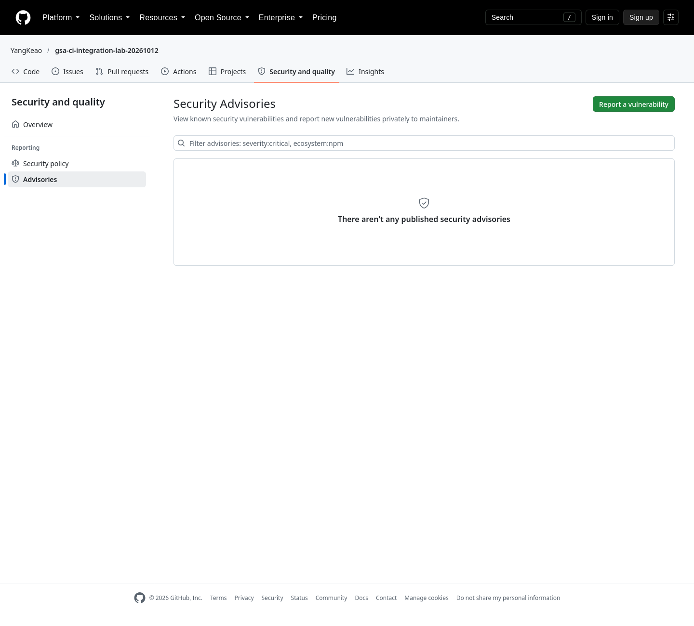
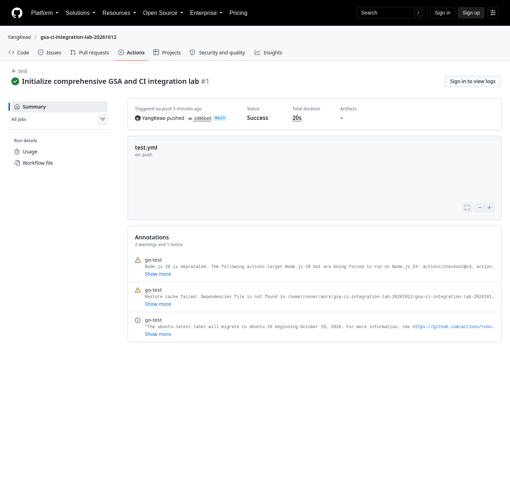
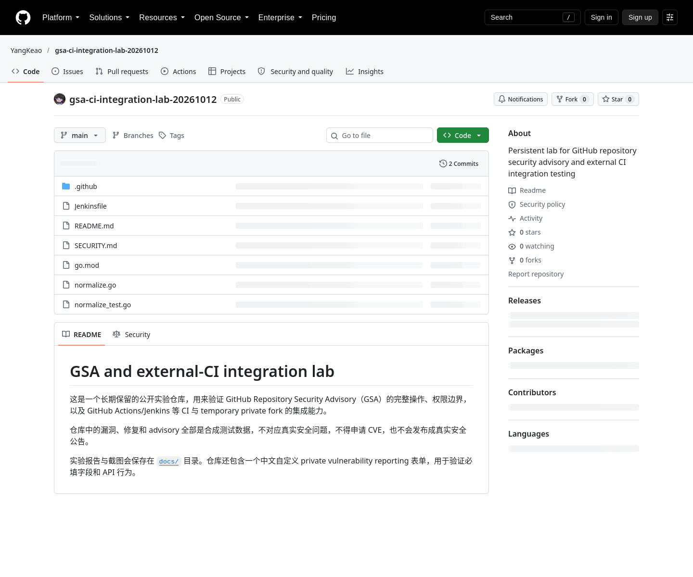

# GitHub Repository Security Advisory 操作与外部 CI 验证报告

实验日期：2026-10-12  
实验账号：GitHub 个人账号 `YangKeao`  
公开实验仓库：<https://github.com/YangKeao/gsa-ci-integration-lab-20261012>

## 1. 结论

1. Repository Security Advisory（下文简称 GSA）和 private vulnerability
   reporting 对 GitHub.com 的**公开仓库**开放；个人账号即可使用，不要求组织账号，
   本实验也没有依赖 GitHub Advanced Security。
2. GSA 能完整承载私密报告、`Triage`、接受/拒绝、私密讨论、协作者、草稿公告、
   GHSA、CVE 申请、temporary private fork、修复 PR 和最终公告发布。
3. temporary private fork 是特殊的隔离工作区，不是普通 private repository。
   GitHub 有意关闭 Actions、第三方 integration、webhook、deploy key、status check、
   branch protection 和普通逐 PR merge。
4. 因此，**TiDB 当前由 GitHub 事件触发、再向提交回写 status 的 Jenkins 接入不能
   直接用于 temporary private fork**。实验中即使使用有 advisory 权限的个人 PAT，
   写 commit status 仍返回 404。
5. 同一凭据可以通过 HTTPS 拉取 temporary fork，所以可以另建一个“人工/轮询 +
   专用用户 PAT”的 Jenkins job 做 checkout 和测试；但它收不到正常 webhook，不能
   回写或强制检查，也没有正常 PR merge gate。这只是脱离 GSA integration 的旁路，
   不应当作为 TiDB 安全发布的主流程。
6. TiDB 若需要完整 CI，推荐用 GSA 负责报告、讨论、GHSA/CVE，修复代码同步到常设的
   private embargo mirror/repository，在隔离 Jenkins 上执行完整流水线，披露时再原子地
   promotion 到公开仓库。

GitHub 的官方限制说明见：

- [Repository security advisories](https://docs.github.com/en/code-security/concepts/vulnerability-reporting-and-management/repository-security-advisories)
- [配置 private vulnerability reporting](https://docs.github.com/en/code-security/how-tos/report-and-fix-vulnerabilities/configure-vulnerability-reporting/configure-for-a-repository)
- [管理私密报告](https://docs.github.com/en/code-security/how-tos/report-and-fix-vulnerabilities/fix-reported-vulnerabilities/manage-vulnerability-reports)
- [temporary private fork 协作与限制](https://docs.github.com/en/code-security/tutorials/fix-reported-vulnerabilities/collaborate-in-a-fork)
- [Repository advisory 权限矩阵](https://docs.github.com/en/code-security/reference/permissions/repository-security-advisory)
- [Repository advisory REST API](https://docs.github.com/en/rest/security-advisories/repository-advisories)

## 2. 实验边界与保留状态

仓库、代码、漏洞和修复均为合成数据，不对应真实安全问题。为了不污染 GitHub
Advisory Database，本实验**没有申请 CVE、没有发布 advisory、没有把私密修复合回
公开仓库**。这些操作的流程和命令在下文记录，但不会对合成漏洞实际执行。

当前保留的痕迹如下：

| 对象 | 状态 | 地址或标识 |
|---|---|---|
| 公开实验仓库 | public，保留 | <https://github.com/YangKeao/gsa-ci-integration-lab-20261012> |
| private vulnerability reporting | enabled | [公开报告入口](https://github.com/YangKeao/gsa-ci-integration-lab-20261012/security/advisories) |
| 自定义报告表单 | public，已生效 | [`.github/VULNERABILITY_REPORT.yml`](../.github/VULNERABILITY_REPORT.yml) |
| 主实验 advisory | `draft`，无 CVE，未发布 | `GHSA-xr65-8ffv-3qw4`；[登录后打开](https://github.com/YangKeao/gsa-ci-integration-lab-20261012/security/advisories/GHSA-xr65-8ffv-3qw4) |
| 生命周期 advisory | 编辑过，经历 `draft → closed → draft → closed` | `GHSA-6m94-xwqx-9rv7`；[登录后打开](https://github.com/YangKeao/gsa-ci-integration-lab-20261012/security/advisories/GHSA-6m94-xwqx-9rv7) |
| temporary private fork | private，保留 | `YangKeao/gsa-ci-integration-lab-20261012-ghsa-xr65-8ffv-3qw4`；[登录后打开](https://github.com/YangKeao/gsa-ci-integration-lab-20261012-ghsa-xr65-8ffv-3qw4) |
| 私密 PR #1 | open，`fix/synthetic-normalization → main` | [登录后打开](https://github.com/YangKeao/gsa-ci-integration-lab-20261012-ghsa-xr65-8ffv-3qw4/pull/1) |
| 私密 PR #2 | open，`docs/independent-main-pr → main` | [登录后打开](https://github.com/YangKeao/gsa-ci-integration-lab-20261012-ghsa-xr65-8ffv-3qw4/pull/2) |
| 额外私密分支 | 已 push；以非 `main` 分支为 base 建 PR 返回 422 | `test/synthetic-regression` |
| 公开 Actions | 已记录的 push run 均成功 | [初始 run](https://github.com/YangKeao/gsa-ci-integration-lab-20261012/actions/runs/38228975018)、[自定义表单 run](https://github.com/YangKeao/gsa-ci-integration-lab-20261012/actions/runs/38229109274)、[报告提交 run](https://github.com/YangKeao/gsa-ci-integration-lab-20261012/actions/runs/38229877850) |

private fork、draft advisory 和私密 PR 对无权限用户表现为 404；这正是预期的保密边界。

## 3. 角色与权限

| 操作 | 普通 GitHub 用户/报告者 | advisory collaborator | 仓库 owner/admin/security manager |
|---|---:|---:|---:|
| 通过启用的入口提交私密报告 | 是 | 是 | 管理员应直接建 draft；本实验 API 报告返回 403 |
| 查看自己提交的报告并讨论 | 是 | 是 | 是 |
| 查看其他 draft advisory | 否 | 仅受邀的 advisory | 是 |
| 创建 draft advisory | 否 | 否 | 是 |
| 增加 advisory collaborator | 否 | 否 | 是 |
| 在 temporary fork push/建 PR | 报告者自动成为 collaborator；或受邀后可做 | 是 | 是 |
| 编辑 advisory metadata/credit | 否 | 受 write/admin 区分 | 是 |
| confidential comment | 报告者若无仓库 write 权限则不可见 | 无仓库 write 权限则不可见 | 是 |
| 接受报告、关闭、申请 CVE、发布 | 否 | 否 | 是 |

重要区别：advisory collaborator 是**单个 advisory 的权限**，不会自动获得公开仓库的
write 权限；reporter 会自动成为该报告的 collaborator 和待接受的 credit。

## 4. 从仓库设置到报告提交

### 4.1 启用 private vulnerability reporting

浏览器路径：

1. 打开仓库；
2. `Settings`；
3. 左侧 `Security and quality` → `Advanced Security`；
4. 在 `Private vulnerability reporting` 右侧点击 `Enable`；
5. 可进入它的 `Settings`，选择是否要求报告者必须分配 CWE。

本实验用 REST API 启用并回读：

```bash
gh api --method PUT \
  /repos/YangKeao/gsa-ci-integration-lab-20261012/private-vulnerability-reporting

gh api \
  /repos/YangKeao/gsa-ci-integration-lab-20261012/private-vulnerability-reporting
# {"enabled":true}
```

启用后的公开页面会出现 `Report a vulnerability` 按钮：



### 4.2 自定义报告表单

仓库内加入 [`.github/VULNERABILITY_REPORT.yml`](../.github/VULNERABILITY_REPORT.yml)。
它与 issue form 使用相同的 YAML schema，可使用 `markdown`、`input`、`textarea`、
`dropdown` 和 `checkboxes`，并可设 `required`、`min_length`。

本实验要求四部分：漏洞摘要、复现步骤、影响与版本、无真实秘密的确认。实际创建
advisory 时，如果 description 没有这些章节，API 返回 422，并逐项列出
`missing_section`；补齐后创建成功。这说明自定义表单不只是浏览器提示，也会约束
REST API 输入。

### 4.3 报告者提交

浏览器路径：

1. 仓库 `Security and quality`；
2. 左侧 `Advisories`；
3. `Report a vulnerability`；
4. 阅读页面上方的 `SECURITY.md`，填写自定义表单；
5. 可勾选是否使用 AI 协助；
6. `Submit report`。

提交后状态是 `Triage`，maintainer 收到通知；报告者自动被加入该 advisory 的
collaborator 和 pending credit。报告者可以继续评论，也可以在 maintainer 接受前先
启动 temporary private fork。

REST API 形式如下，其中 description 必须匹配自定义表单章节：

```bash
gh api --method POST \
  /repos/OWNER/REPO/security-advisories/reports \
  --input report.json
```

本实验只有仓库 admin 身份。GitHub 对该身份调用报告接口返回 403：管理员不能把自己
伪装成外部报告者，应使用下面的 `POST /security-advisories` 直接创建 draft。因此本次
没有伪造第二个账号；报告入口和表单已保留，若要实测 `Triage → accept/reject`，需由
一个非 admin GitHub 账号提交这份无害报告。

## 5. Maintainer 的 triage、接受和拒绝

浏览器路径：`Security and quality` → `Advisories` → 打开状态为 `Triage` 的报告。

维护者可做四类操作：

1. 评论追问信息；普通评论对 reporter 和所有 collaborator 可见。
2. 勾选 `Confidential` 后评论；只对有仓库 write 权限的维护者可见，报告者和仅有
   advisory 权限的 collaborator 看不到，而且评论发布后不能在普通/保密间切换。
3. 点击 `Start a temporary private fork` 开始协作；这不会改变 `Triage` 状态。
4. 点击 `Accept and open as draft`，将报告接受为正常 draft advisory；不会公开。
5. 如果确认不是安全问题，应先评论解释原因，再点击 `Close security advisory`。

接受/拒绝是 maintainer 对 reporter 提交物的动作；本实验无法用同一个 admin 账号
制造 `Triage`。不过我们另外创建了生命周期 advisory，实际验证了编辑、关闭、重新
打开、再次关闭；事件和最终 `closed` 状态保留在 `GHSA-6m94-xwqx-9rv7`。

## 6. Maintainer 直接创建、编辑和关闭 advisory

浏览器路径：

1. `Security and quality` → `Advisories`；
2. `New draft security advisory`；
3. 填写标题、CVE 状态、说明、severity、CWE、ecosystem/package、受影响/修复版本、
   vulnerable functions 和 credits；
4. `Create draft security advisory`。

本实验创建主 draft 的命令等价于：

```bash
gh api --method POST \
  /repos/YangKeao/gsa-ci-integration-lab-20261012/security-advisories \
  --input advisory.json
# GHSA-xr65-8ffv-3qw4, state=draft, severity=low
```

编辑 metadata：

```bash
gh api --method PATCH \
  /repos/YangKeao/gsa-ci-integration-lab-20261012/security-advisories/GHSA_ID \
  -f summary='新的摘要' -f severity=medium
```

severity 的 API 枚举是 `critical|high|medium|low`；实验传入 `moderate` 得到 422，改成
`medium` 后成功。

关闭和重新打开：

```bash
gh api --method PATCH /repos/OWNER/REPO/security-advisories/GHSA_ID \
  -f state=closed
gh api --method PATCH /repos/OWNER/REPO/security-advisories/GHSA_ID \
  -f state=draft
```

关闭 draft 不会公开它；本实验最后又将生命周期 advisory 置为 `closed`。

## 7. 协作者、credit、CVE 与发布

### 7.1 添加协作者和 credit

在 draft advisory 页面右侧：

- `Collaborators` → 邀请 GitHub 用户或 team；他们只获得该 advisory/private fork 的
  协作权限；
- `Credits` → 增加 finder、reporter、analyst、coordinator、remediation developer、
  reviewer、verifier 等类型；被 credit 的用户需接受，发布后才会公开显示。

本实验没有邀请无关用户，以免发送真实通知。权限矩阵和按钮位置按官方文档记录。

### 7.2 申请 CVE

如果仓库是公开的、advisory 是真实且已准备好，页面可点击 `Request CVE`；REST API：

```bash
gh api --method POST \
  /repos/OWNER/REPO/security-advisories/GHSA_ID/cve
```

GitHub 正式接受请求后会进入处理流程。**本实验严禁执行这条命令**，因为合成测试不应
占用 CVE，也不应进入公开漏洞数据库。

### 7.3 发布

发布前应完成 affected/patched versions、severity/CVSS、CWE、credit、fix 和发布制品。
页面点击 `Publish advisory` 会公开内容；API 相当于把 state 更新为 `published`。
发布可能同时把 advisory 提交到 GitHub Advisory Database，并将 temporary fork 的
变更并入公开仓库。已发布 advisory 不能当作普通草稿随意删除，删除通常需要联系
GitHub Support。

**本实验没有发布**，也没有展示一条可直接复制执行、指向本实验 GHSA 的发布命令，
以避免误操作。

## 8. Temporary private fork、分支和 PR

创建 private fork：

```bash
gh api --method POST \
  /repos/YangKeao/gsa-ci-integration-lab-20261012/security-advisories/GHSA-xr65-8ffv-3qw4/forks
```

返回的 fork 是：

```text
YangKeao/gsa-ci-integration-lab-20261012-ghsa-xr65-8ffv-3qw4
```

它的 API metadata 曾返回 `default_branch=master`，但实际 Git ref 是 `main`；自动化
不要只相信该字段，应以 `git ls-remote` 或 branch API 复核。

有 advisory 权限的凭据可拉取和推送：

```bash
git ls-remote \
  https://github.com/YangKeao/gsa-ci-integration-lab-20261012-ghsa-xr65-8ffv-3qw4.git

git remote add security \
  https://github.com/YangKeao/gsa-ci-integration-lab-20261012-ghsa-xr65-8ffv-3qw4.git
git push security fix/synthetic-normalization
```

禁用 credential helper 后，同一地址因无法认证而失败：

```bash
git -c credential.helper= -c core.askPass= ls-remote PRIVATE_FORK_URL </dev/null
# fatal: could not read Username ...
```

本实验保留了三个分支和两个 PR：

```text
fix/synthetic-normalization  ── PR #1 ──> main
docs/independent-main-pr     ── PR #2 ──> main
test/synthetic-regression    ── 尝试 PR ─> fix/synthetic-normalization（422）
```

关键结果：

- PR #1、#2 的 `statusCheckRollup` 都是空数组；
- `PUT /pulls/1/merge` 返回 404，不能走普通 PR merge；
- 以 `fix/synthetic-normalization` 为 base 创建第三个 stacked PR 返回 422
  `base invalid`；
- GitHub 官方要求通过 advisory 页的 `Merge pull requests` 一次性处理，而且最终只能有
  一个 PR 指向默认分支；若有两个指向 `main` 会阻止 advisory-level merge。

本实验故意保留 PR #1、#2 同时指向 `main`，方便登录后观察限制；没有点击
advisory-level merge，避免任何合成修复进入公开仓库。

## 9. GitHub Actions 与第三方 CI 实测

### 9.1 公开仓库基线

公开仓库包含 `.github/workflows/test.yml`，报告中记录的 push run 均运行成功：



仓库首页和公开实验说明：



### 9.2 Temporary fork 的接口结果

| 检查 | 结果 | 含义 |
|---|---|---|
| 有权限的 HTTPS `git ls-remote`/push | 成功 | advisory collaborator 可以直接操作 Git 数据 |
| 无凭据 `git ls-remote` | 失败 | fork 对公众不可见 |
| `GET /actions/runs` | 404 | Actions 不可用 |
| `GET /hooks` | 404 | 无法把正常 webhook 接入 Jenkins |
| `GET /keys` | 404 | 不能配置 deploy key 给 Jenkins |
| `GET /installations` | 404 | 正常 GitHub App installation 不可见/不可接入 |
| PR `statusCheckRollup` | `[]` | 没有检查运行 |
| 用有权限 PAT `POST /statuses/{sha}` | 404 | 即使旁路 Jenkins 跑完，也不能按普通方式回写 commit status |
| 普通 PR merge API | 404 | 不能逐 PR merge |

写 status 的实测命令使用 synthetic context，仍返回 404：

```bash
gh api --method POST \
  /repos/YangKeao/gsa-ci-integration-lab-20261012-ghsa-xr65-8ffv-3qw4/statuses/2cf468093d83382c7d0c6e93ec72a1ade4d32f88 \
  -f state=success \
  -f context='external/jenkins-pat-synthetic' \
  -f description='Synthetic manual Jenkins-style status; no Jenkins server ran'
# HTTP 404
```

这排除了一个容易误判的方案：**不是“Actions 被关，但 Jenkins 用 PAT 回写 status 就
行”**；GitHub 连这个普通 status 写入路径也对 temporary fork 隐藏。

## 10. TiDB 当前 Jenkins 能否接入

### 10.1 当前 TiDB 路径

TiDB 的公开 PR 上能看到大量 Jenkins context，例如
[`pingcap/tidb#71855`](https://github.com/pingcap/tidb/pull/71855) 的：

```text
idc-jenkins-ci-tidb/build
idc-jenkins-ci-tidb/check_dev
idc-jenkins-ci-tidb/mysql-test
idc-jenkins-ci-tidb/unit-test
pull-integration-e2e-test
pull-unit-test-next-gen
```

它们链接到 `https://do.pingcap.net/jenkins/...`。仓库根目录的
[`Jenkinsfile`](https://github.com/pingcap/tidb/blob/master/Jenkinsfile) 还会用
`github-iamxy-ssh` credential 从 `pingcap/SRE` 加载 Groovy pipeline。

这条链路的前提是：GitHub integration/bot 能看见仓库和 PR 事件，Jenkins 的 SCM
credential 能 checkout，最终还能向公开 commit 回写 status/check。temporary private
fork 在前三个 integration 面全部切断，所以**现有 TiDB Jenkins job 不能原样接入**。

### 10.2 四种接入方式的判断

| 方案 | 能 checkout | 自动触发 | 回写/强制 gate | 结论 |
|---|---:|---:|---:|---|
| 当前 TiDB GitHub App/webhook + SSH credential | 否 | 否 | 否 | 不可用 |
| GitHub Actions/self-hosted runner | 否 | 否 | 否 | GitHub 明确不运行 |
| 专用 advisory collaborator 用户 PAT + Jenkins polling/manual build | 是 | 只能轮询/人工 | 否 | 技术上能跑测试，但不是 GSA CI 集成，不适合作为发布 gate |
| 常设 private embargo mirror + 独立 GitHub App/Jenkins | 是 | 是 | 是 | 推荐 |

“PAT + polling”的最小做法是：

1. 建立一个专用 GitHub 用户，按 case 邀请为 advisory collaborator；不要复用工程师个人
   token；
2. 将 fine-grained PAT 放入 Jenkins credential store，权限和仓库范围最小化；
3. Jenkins job 由人工触发，或在已知 GHSA/fork 名称上低频轮询；
4. checkout 后立即记录准确 SHA，在隔离 agent 上禁用共享 cache、公开日志和外部上传；
5. 测试结果写回内部 case 系统或 GSA 评论，而不是期待 GitHub status；
6. maintainer 在 advisory 页面人工核对 SHA、测试结果和 reviewer 后再执行 advisory merge。

即使如此，它仍缺失事件、GitHub gate 和可证明的一致性；Jenkins 日志、artifact、cache、
测试依赖访问也都扩大 embargo 泄漏面。只适合一次性补充验证，不适合 TiDB 的多组件、
多版本安全发布。

### 10.3 推荐的 TiDB 形态

```text
GSA/private report
  ├── discussion, reporter, credit, GHSA/CVE
  └── canonical minimal fix metadata
                    │ controlled sync
                    v
standing private embargo repos/mirrors
  ├── normal GitHub App/webhook
  ├── isolated Jenkins agents/cache/log/artifacts
  ├── one PR per vulnerability
  ├── supported release-line backports
  └── signed immutable RC + manifest
                    │ coordinated disclosure time
                    v
public commits/tags + promote identical artifacts + publish advisories
```

GSA 仍然有价值，但它负责 case/advisory，不负责成为 TiDB 的完整私有 CI 平台。

## 11. 操作清单

### 日常准备

- 公开仓库设置 `SECURITY.md`；
- 开启 private vulnerability reporting；
- 配置自定义 form 和可选的 CWE 强制；
- 管理员订阅 `Security alerts` 通知；
- 预先建立 private embargo repo、隔离 Jenkins 和凭据轮换；
- 明确哪些信息可写 GSA，哪些只能进入内部 case；
- 准备 CVE、advisory、release、泄漏和提前公开模板。

### 每个报告

- 确认 reporter、时间、复现和保密范围；
- `Triage` 阶段追问，必要时使用 confidential comment；
- 接受为 draft 或解释后关闭；
- 指定 coordinator、component owner、reviewer 和 release lead；
- 一项 independently fixable vulnerability 一个 case/GHSA/CVE；
- temporary fork 只用于小修；需要完整 CI 时同步到 embargo mirror；
- 修复、测试、受影响版本、backport、artifact digest 和 CRD 进入同一 manifest；
- 发布日同步公开 commit、tag、制品、advisory 和升级指南。

### 发布前的禁止项

- 不在合成/未确认漏洞上申请 CVE；
- 不在公开 PR、公开 Actions log 或公共 artifact 中泄漏 fix；
- 不把“Jenkins 本地跑过”误当作 GitHub enforced check；
- 不把 temporary fork 当成普通 private repo；
- 不让个人长期 PAT 成为安全发布单点；
- 不在未经验证时点击 advisory-level merge 或 publish。

## 12. 旧实验仓库的清理状态

旧的最小仓库是：
<https://github.com/YangKeao/gsa-workflow-sandbox-20261012>。

已执行删除尝试，但当前 `gh` token 只有 `repo, workflow, read:org, gist`，缺少
`delete_repo` scope，GitHub 拒绝删除。没有为了删除仓库而导出、索取或扩大任何凭据。
仓库 owner 可在网页执行：

`旧仓库 Settings → General → Danger Zone → Delete this repository`

也可以显式为 CLI 重新授权 `delete_repo` 后执行：

```bash
gh auth refresh -h github.com -s delete_repo
gh repo delete YangKeao/gsa-workflow-sandbox-20261012 --yes
```

本次完整实验仓库及其安全痕迹应继续保留。
